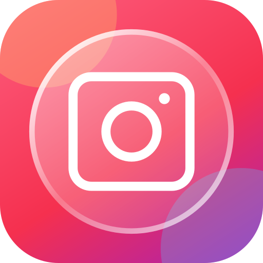

<div align="center">



# IG Liquid Glass

An experimental Instagram port of AM Liquid Glass. An LSPosed / Xposed module for Android 13+.

</div>

## What changes

- A floating glass bottom navigation capsule, with live background blur and edge refraction.
- A selection lens that grows when pressed. Drag the selected tab horizontally and release to navigate.
- Instagram's original buttons stay visible and functional, including avatars, badges, accessibility labels, tab reselection, and long presses.
- The dock follows Instagram's light/dark theme, navigation visibility, animations, layout direction, and system navigation insets.
- Reels metadata, follow/caption controls, right-side actions, and the native timeline sit above the floating dock. The timeline uses an inset rounded track and an interaction thumb.

This port covers the main bottom navigation and spacing/playback styling for the native Reels overlay. Apple Music's mini player, settings, font, color, popup, and transition hooks were specific to that app and have been removed. Instagram's headers, menus, and settings keep their original appearance.

## Compatibility and status

| | Target |
| --- | --- |
| Instagram | **454.0.0.54.77**, version codes **386014705 / 386014758** |
| Package | `com.instagram.android` |
| Android | 13+ |
| Framework | LSPosed, Vector, or another Xposed API 82 framework |
| Layout | Horizontal main navigation with 3–6 tabs inside a `FrameLayout` |

The port was compiled and checked with Android lint against the supplied APKM. On-device checks with Android 14 and Vector confirmed the floating dock and raised Reels metadata/actions; no further native crash was observed after removing background draw hooks. Final timeline appearance and scrubbing verification remain incomplete. See [reference notes](docs/instagram-reference.md).

Other app versions are skipped. Unsupported layouts keep the stock navigation; an installation or rendering failure triggers cleanup and restoration. Separate video surfaces may not appear in the sampled backdrop. The original Apple Music screenshots in `docs/` are not previews of this port.

## Build and install

Needs JDK 21 and Android SDK 37. Configure `ANDROID_HOME` or `sdk.dir` in `local.properties`, then run:

```sh
./build.sh
```

Use `./build.sh --debug` for a debug APK, or add `--lint` to check the selected build variant. Extra Gradle options follow `--`, for example `./build.sh --lint -- --no-daemon`. Run `./build.sh --help` for requirements and signing notes. The script uses the pinned Gradle wrapper and prints the APK path.

1. Install `app/build/outputs/apk/release/app-release.apk`.
2. In LSPosed, enable **IG Liquid Glass** and select **Instagram** as its scope.
3. Force-stop Instagram and open it again.

```sh
adb install -r app/build/outputs/apk/release/app-release.apk
adb shell am force-stop com.instagram.android
```

The module ID is `dev.dimka.igglass`, so it can coexist with AM Liquid Glass. Builds use the local debug signing key; updates must use the same key.

## How it works

The module registers activity lifecycle callbacks in Instagram's main process and finds `tab_bar` by its resource name. A module-owned Compose view is inserted immediately behind the native navigation, without moving or replacing its buttons.

Before each window draw, the module records sibling content display lists into a hardware `RenderNode`, excluding the native navigation and glass view. The backdrop library samples that node. Main content can extend underneath the floating dock. The stock background and separator are suppressed while it is installed; drawable alpha hides native fills without hooks on background drawing. Instagram can still read its native background objects and RGB colors.

Native taps and long presses continue through Instagram. Touches are mirrored to the glass for animation. A horizontal drag starting on the selected tab cancels the native press, then invokes the destination button's original click handler on release. Each activity owns its composition, gesture hook, and reversible view changes. Module resource IDs use package `0x6e` to avoid Instagram's `0x7f` IDs.

Source: [`app/src/main/java/dev/dimka/igglass`](app/src/main/java/dev/dimka/igglass). Build checks and device verification steps: [CONTRIBUTING.md](CONTRIBUTING.md).

## Credits

Ported from AM Liquid Glass in this repository. Glass rendering uses [Kyant0/AndroidLiquidGlass](https://github.com/Kyant0/AndroidLiquidGlass): the `backdrop` library and the adapted `LiquidBottomTabs` catalog code and helpers in [`catalog/`](app/src/main/java/dev/dimka/igglass/catalog), under Apache-2.0.

Not affiliated with Instagram or Meta.

## License

[Apache-2.0](LICENSE)
